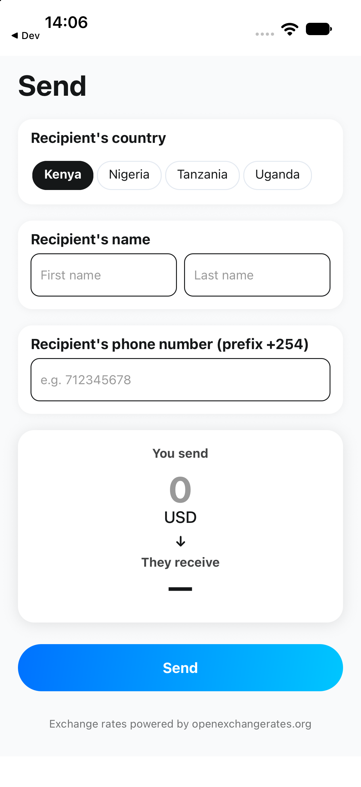

# React Native New Architecture example

[](https://github.com/GeorgianSorinMaxim/react-native-example-new-arch/actions/workflows/ci.yml)
[](LICENSE)

This is a React Native app that runs on the New Architecture (Fabric and TurboModules), with Expo Router, the React Compiler, Reanimated, strict TypeScript, and unit tests with React Native Testing Library. It is a small money-transfer app example that uses exchange rates from Open Exchange Rates.

<p align="center">
  
</p>

## Versions

| Tool         | Version |
| ------------ | ------- |
| Expo SDK     | 58      |
| React Native | 0.88    |
| React        | 19.3    |
| TypeScript   | 6.0     |

The New Architecture is on (`newArchEnabled` in `app.json`).

## Run it

```bash
npm install
npx expo run:ios      # or: npx expo run:android
npm run lint && npm run tsc && npm test
```

The app uses native code, so it needs a development build (`expo run:*`). Expo Go does not work.

## Project layout

- `app/`: Expo Router entry point
- `screens/send-screen/`: the send form, exchange-rate hook, and tests
- `components/`, `hooks/`, `constants/`: shared UI and theme code

## Licence

[MIT](LICENSE)
